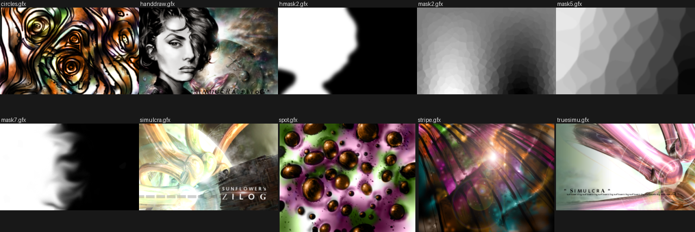
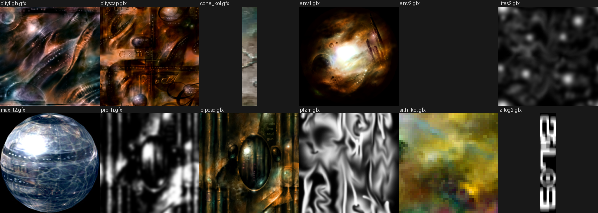
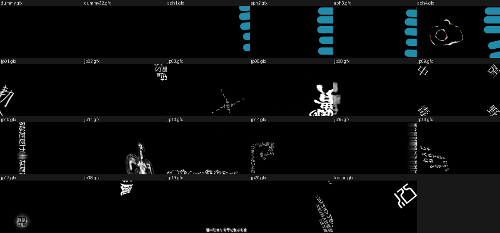
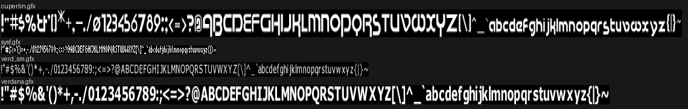
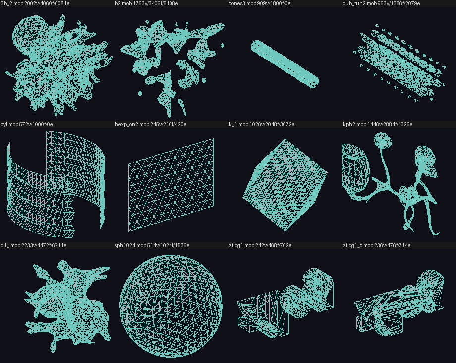

# ZILOG (Sunflower, 1999) - effects, engine, tricks and scenes

*ZILOG* by **Sunflower** (mrock, falcon, visualize, voomie): a 32-bit DOS demo (PMODE/W extender, Watcom C, x87 floating point, no MMX), 320x200 **true colour**
(a 32-bit buffer of 64000 dwords, presented through VESA; the demo tries 32, 24, 16, 15 and 8 bpp). Music is a 28-channel `USLM` module (`ana.u`) played by the
*Useless Sound System* v1.04. Everything the demo loads comes from one LZW container (63 files, appended to `ZILOG.EXE`). The port is in `site/js/`
(ES modules, no build); everything below is checked against `re/*.md`, the JS sources and the machine code in `re/image.bin` (unpacked, load address 0x10000).

How "exact" is used here: the 2D library, the 3D engine and the music player were compared with the **original machine code run under Unicorn** on real data
(`tools/test/run_*.sh`); the scene-level code was compared the same way for the scene-specific functions, but **whole frames were only compared by eye** with a
DOSBox capture (structure, motion, colours). So: functions are bit-exact (unless said otherwise), scene timing/composition is faithful but not pixel-verified.

## 0. At a glance

| tick | what | how it is driven |
|---|---|---|
| main loop | 11 loops `while (order < N)`, N = 5, 14, 19, 23, 27, 31, 35, 41, 49, 51, 60 | the **music position** (order, row), read from the sound system's IRQ callback |
| ISR | 70 Hz timer (func 0x10010): tick counter | scene time `t = ticks*0.25 - base` (float32) |
| host | one frame per iteration, dt = ticks since the previous frame | accumulations such as fades are `x += dt * k` |

* **Display.** 320x200 square-pixel buffer, shown 4:3 by the player. A screen dword is `0x00RRGGBB` (byte0 = blue). The flip (0x17c11) copies it to VESA memory;
  in 565/555 modes it quantises. The port presents the 32 bpp path (`presentToRGBA`). *Exact.* The DOSBox reference video is R/B swapped for direct-colour modes
  (verified with a 29 byte test `.COM`), the port is not.
* **Timeline = song position.** Scene boundaries (order reached) in seconds of music, from `re/PORT_music.md`:

| time | order | scene |
|---|---|---|
| 0:00 - 0:17.3 | 0..4 | **scene 0**: the wire knot |
| 0:17.3 - 0:48.5 | 5..13 | **scene 1**: "simulcra", plasma reveal, glow spirals |
| 0:48.5 - 1:07.5 | 14..18 | **scene 2**: chrome blob in a bubble field |
| 1:07.5 - 1:21.4 | 19..22 | **scene 3**: refracted pipes |
| 1:21.4 - 1:35.2 | 23..26 | **scene 4**: bronze blob over pink tubes |
| 1:35.2 - 1:49.0 | 27..30 | **scene 5**: glow-sprite tornado |
| 1:49.0 - 2:02.9 | 31..34 | **scene 6**: brown blob over the swirl |
| 2:02.9 - 2:23.7 | 35..40 | **scene 7**: wire lattice and a black hole |
| 2:23.7 - 2:51.3 | 41..48 | **scene 8**: hexagon tiles, the drawing, sprite spiral, tunnel wipe |
| 2:51.3 - 2:58.3 | 49..50 | **scene 9**: cube tunnel and wire grid |
| 2:58.3 - 3:29.4 | 51..59 | **credits** (`while (order < 0x3c && DAT_000314f5 == 0)`) |

  Because the demo only needs `(order, row)` and a sticky "sync marker" value (a module effect, command 0x20/0x33, stored in `DAT_000314f4`), the port seeks by
  setting the module position. Note the loop that follows scene 9 is the credits loop: the decompiler/task numbering has 10 numbered scenes plus it (11 loops).
* **Music** (`music/usm.js`): *bit exact* against the original mixer, every sample of the 10448 blocks (209.434 s), plus ~110 fuzzed module variants. It assumes the
  Sound Blaster 16 path (44.1 kHz stereo 16-bit software mixer) that DOSBox gives; other SB modes of the original are not ported.
* **Sync markers drive the flashes.** `sync & 15` (low nibble) picks a small picture (`smalpics/jp*.gfx`) that is blitted additively or as a difference; `sync & 0x10`
  fires a colour-matrix rectangle. `sync` is *sticky*: the main loop never clears it, so the same picture keeps being drawn until the next marker changes it.

## 1. The 2D library: no multiplications

Every blend in the demo is done by a **lookup table** indexed with pixel bytes, and the same ~40 routines are used by all scenes (`re/PORT_2d.md`).

* **Two 64 KB blend tables** (func 0x14834): `T1[a<<8|b] = 255 - ((255-a)*(255-b) >> 8)` (the "screen" blend, `lut1` / `DAT_000402f4`) and `T2 = ~T1` (`lut2`).
  The port builds them literally:
  ```js
  t1[o] = (255 - (((255 - y) * (255 - x)) >>> 8)) & 255;   // y = row, x = column
  t2[o] = ~t1[o] & 255;
  ```
  `T1[alpha][c]`-style lookups give `c*alpha/255`-like products for free (the second index is complemented first, hence the `~` everywhere).
* **Spots and plasma are generated at start-up** by float code, *bit-exact* in the port: `radialCosSpot` (0x14639) is a 256x256 byte soft disc
  `255*(0.5+0.5*cos(r/40.4))` with `r = hypot(1.17*y, x)` clamped to 127 (rows stretched 1.17, so it is round on a non-square pixel display);
  `cosCosPlasma` (0x14c51) is the "egg box" `16 + 56*(1+cos x')*(1+cos y')`. The only place where double precision is *not* enough is the ray table 0x14d0b:
  `trunc(r*cos+100)` needs the x87's 64-bit mantissa (residue -1.8e-16 at 3*pi/2 makes the original produce 99, not 100), emulated with an exact residual (`truncSum`).
* **Sprites** (`spriteAddAlpha` 0x1f6b2, `spriteSubtract` 0x1f337 ...): the 256x256 byte spot is scaled onto a box of 2R pixels with a 24.8 position/radius, and added
  (saturating, per byte) or subtracted. The alpha version routes the spot through `T2[alpha][~m]`. *Exact.*
* **Colour matrix** (`colorMatrixRect`, 0x22990): nine 256-entry int32 tables (8.24 fixed point, built by 0x148c4) so that a 3x3 colour matrix is nine loads and six adds:
  `out_c = ((T[3c][b0] + T[3c+1][b1] + T[3c+2][b2]) >>> 24) + 0x70` (byte store, no clamp). The matrix is YCbCr-like; this is what makes the grey/green strips that flash on
  the beat.
* **Mask wipes.** `maskFadeToBlack` (0x1ec58), `maskWipeCrossfade` (0x1ecaa), `alphaMaskCrossfade` (0x1ee44), `maskInvert` (0x1eeb4) take an 8-bit image as a mask. With
  `k = mask - threshold`: `k<=0` keep the pixel, `k>31` apply the full effect, otherwise one table lookup per channel produces a 31-step soft edge. The threshold ramps
  with time, so the effect sweeps across the picture in the *shape of the mask*:
  ```js
  const k = mask[i] - thr;
  if (k <= 0) continue;
  scr[i] = k > 0x1f ? 0 : lk(T, k << 3, ~scr[i] >>> 0);      // maskFadeToBlack
  ```
* **Blurs.** Box blur horizontal/vertical (0x16cdd, 0x16e53), per-scanline radius (0x16ffb) and a *radial path blur* (0x1743b: a running sum along a precomputed list of
  pixel offsets). *Exact*, with documented caveats: radius must be >= 3 (smaller radii make a `dec ecx` loop wrap 2^32 times; never used), and the radial blur in
  scene 7/8 reads the ray table 256 entries past its end (heap in the original, zeros in the port).
* **Text** (`printText` 0x17641): a font object built from an 8-bit strip (glyph boundary = an all-zero pixel column) and **in-band control bytes** (`0x08 alpha`,
  `0x0b` toggle darken...). Scenes build the string with `sprintf` and then *patch the alpha byte* in the buffer to fade the text:
  `txt[1] = Math.trunc(v38)` (scene 1), or `buf[1] = trunc(120 sin t + 128)` (scene 4).
* **Grid warp** (0x1d6a4, 0x1e266, 0x1e62e, 0x1e941): the screen is 40x25 cells of 8x8 pixels; a 41x26-node mesh of three 8.16 attributes (texture u, v, shade) is
  interpolated bilinearly per cell, and each pixel is `T[shade<<8 | texel]`. Only 1066 nodes need trigonometry; the 64000 pixels are interpolated. The node tables are
  built every frame by the scene functions (`warpMeshLens`, `warpMeshA/B`, `lensNodes` below). *Exact*, except the lens node tables, whose x87 `fsin`/`fcos` of large
  arguments differ by <= 2 LSB in a few nodes (`0x1d200` at T=2600: 27 of 1066 nodes; `0x1ce90`: 71 % of 22386 values identical, rest +-1).

## 2. The 3D engine ("mobutil.c")

A compact float engine (`lib/mesh3d.js`, `mesh3d-raster.js`), compared with the original on 206 checks (loader, transforms, 95 render cases covering every
(mode, sub) used by `main`): **pixel exact**, including the face sort order.

* **Meshes** are `.mob` files (`PNTS` float xyz, `FACE` 3 x u32, `EDGE` 2 x u32 chunks). The loader builds vertex-to-face lists (by *prepending*, so a vertex's faces
  come out in decreasing order) and, for each edge, the first two faces common to both ends.
* **Pipeline per object**: `rotate` (Euler; in modes 0 and 2 the source is the *already transformed* array, i.e. cumulative, in place) -> `faceNormals` / `vertexNormals`
  (once for env-mapped objects) -> `project`: `invz = 1/(z/focal + dist)`, `x' = x*invz + cx`, `y' = cy + y*invz*0.83` (the 0.83 is the non-square pixel correction;
  a double constant in the code) -> `render(mode, sub)`.
* **Face order.** Back-face cull by integer screen area, key `trunc((z0+z1+z2)*100)` of the transformed vertices, sorted descending with the demo's own Hoare quicksort
  (not stable, ported literally so that ties come out the same). No z-buffer: painter's algorithm.
* **Render modes**: 0/1 faces env-mapped (u = nx*127+127, v = ny*127+127 from the vertex normal), 2/3 env + surface texture added (`tri_266a0`), 4 textured, 5 silhouette
  edges (an edge with one front and one back face), 6 the same with per-vertex colour, 7/8 all edges, 9 a **soft sprite at every vertex** (radius = 26*invz), sub 3 coloured.
  Lines are anti-aliased through the blend tables; polygons are clipped (Sutherland-Hodgman) against the screen.
* **Pointer tricks**: textures must be 256 KB aligned in the original (pointer in the high half of a register); the port takes plain typed arrays. Out-of-range texture
  reads (screen-space textures with uv outside the picture) read heap in the original and give 0 in the port; not used meaningfully.
* **x87 precision.** The original keeps intermediates in 80 bit and rounds to float32 only at `fstp dword`; the port uses doubles with `Math.fround` at the same stores.
  On all test vectors this is bit identical. A harness trap worth knowing: Unicorn starts with x87 control word 0 (24-bit precision); with it the sort key
  `trunc((z0+z1+z2)*100)` differs by one for some faces. The demo runs `fninit` (0x37f).

## 3. Scene by scene

All scene timings come from the music position; time `t = ticks*0.25 - base` is float32, with the base re-set at the start of most scenes (scenes 8 and 9 do *not*
re-base: the port derives their base `BASE7` from the music time of order 35, which only phases the swirl centres, not their look).

### Scene 0 - the knot (0 - 17.3 s)
Black screen, a tangled wire sphere-knot (`3b_2.mob`) rises from below and wobbles on a Lissajous path (`cx = 220 + 50 sin(..)`, `cy = 100 + 50 cos(..) + 240 decaying at 0.7/tick`).
Drawn twice: **mode 5** (anti-aliased silhouette lines, grey 255), then **mode 9/3** with `mesh.npts` temporarily set to `min(order*64 + row, npts)`: the vertex sprites
appear **one per music row**, then the count is restored. Sprite colour of vertex i is the i-th pixel of `silh_kol.gfx` (a 45x45 gold gradient). The rotation angles
are `3 sin(cos(0.008 t) + 0.009 t)` and similar: nested sin/cos give smooth pseudo-random wandering.
```js
mesh.npts = Math.min(st.pos, nOrig);   // points are revealed one per music row
obj.mode = 9; render(obj, ctx);
mesh.npts = nOrig;
```
Post: vertical box blur with radius `int(3 sin(cos(0.5t)+0.1t)+7)` (4..10, "breathing") into a second buffer; on sync markers 2/3 a horizontal blur of radius 50 that decays by 3/tick
(min 3) smears the object on the beat. Marker 1 prints "ugly, discrete jumps". Library code only; every function exact, the whole composition verified by eye. (`rotateNormals` is
called by the original but unused in modes 5/9, so it is skipped.)

### Scene 1 - "simulcra" (17.3 - 48.5 s)
The full-screen picture `simulcra.gfx` (orange glass tubes) is copied each frame, then:
1. **Reveal (first ~6 s).** An 8-bit plasma (`cosCosPlasma`) is rendered through a 41x26 *lens mesh* (func 0x1d200) by the 8-bit grid warp into a mask, and
   `maskFadeToBlack(scr, mask, thr)` with `thr = -32 + 0.7*ticks` (until 260) darkens every pixel whose mask is above the threshold: the picture emerges from black
   through a swirling plasma pattern.
2. **Glow spirals.** 16 curves of ~105 `spriteAddAlpha` sprites on Lissajous paths (~1700 sprites per frame):
   ```js
   const s = F(((Math.trunc(T * 130 + i)) & 0xffff) * 0.003);
   const x = F(S(i*0.2 + T*0.02 - C(i - T*0.01)) * 60 + 160 + C(ang) * (s*s*0.01));
   const y = F(S(ang) * s + (S(i*0.3 + T*0.013) * 60 + 100));
   const sz = F(S(fs*T*0.14 + ang + i) * 4 + 5);       // fs = +1/-1: odd and even rings counter-rotate
   const alpha = Math.trunc(255 - v48*12 + v48*sz);    // v48 grows to 21 (orders 5,6), decays after order 9
   ```
3. **Text** on sync markers 1/2 ("art is not" / "what you see", darken mode), fading by patching the alpha byte.
4. **Plasma inversion** (order > 9): a second lens mesh (0x1d3d8, two independent lenses) feeds `maskInvert`: the plasma value is the per-pixel *amount of colour inversion*.
5. **Exit** (pos >= 0x340): `maskFadeToBlack` with `mask5.gfx` as the mask, threshold `270 - 1.2*ticks`: a wipe to black along the mask shape.

Lens mesh (0x1d200): per node a rotation of (x,y) by a wobbling angle, scaled by `1/(0.001*(a x^2 + b y^2) + c)`, times 524288, `fistp`, `& 0xffffff`. Validation: 15 of 16 vectors bit-identical;
the 16th (T = 2600, far beyond the demo) differs in 27 of 1066 nodes by <= 2 (x87 `fsin` of large arguments vs libm).

### Scene 2 - chrome blob in a bubble field (48.5 - 67.5 s)
Background `spot.gfx` (blurred purple/green light burst). On top: an environment-mapped blob (`b2.mob`, env `max_t2.gfx`) wobbling so violently it looks like a spiky star,
1024 dark glossy **bubbles** (`sph1024.mob`, every vertex a *subtractive* soft sprite), a ring wireframe (5 concentric 26-gons, radius 800), a 70 px additive light sprite
and a four-line crosshair (255 at the centre fading to 0 at the border). Sync 1 flashes `jp09.gfx`. It starts with a fade-in from black through `mask2.gfx`.
* **Wobble** (0x206e0): vertex -> spherical (two `fpatan`), `r' = r + 140 sin(cos(B r - e) + A r + d)`, back to cartesian. Because the displacement is a function of the *radius only*,
  it looks like shock waves running through the shape; applied to the flat ring mesh it turns it into a bowl.
  ```js
  const phi = F(A2(y, x)), theta = F(A2(Math.sqrt(y*y + x*x), z)), r = F(Math.sqrt(z*z + (y*y + x*x)));
  const r2 = F(S(C(B*r - e) + (A*r + d)) * 140 + r);
  ```
* **Depth interleaving without a z-buffer.** The mesh and the sphere are each drawn in **two halves** (functions 0x1a7df / 0x1aa02, 0x1a21b / 0x1a5ea, identical but for one
  compare): faces whose sort key is > 0 (behind z = 0) first, then the light sprite, ring and crosshair, then faces with key < 0 and the near bubbles. Layering is correct
  for those objects without a depth buffer.
* **Ring mesh** (0x1bdb0): 5 rings x 26 points, radii R/5..R, edges `(j*26+i, j*26+(i+1)%26)`; it is a legitimate mesh so the wobble, projection and edge renderer are reused.
Status: ring, wobble, sine blob, colour waves bit-identical; far/near faces and sphere sprites pixel-exact given the same projected arrays.

### Scene 3 - refracted pipes (67.5 - 81.4 s)
Full-screen pipes (`pipesd.gfx`) with moving light streaks (`lites2.gfx` pushed through a bump displacement map built from `pip_h.gfx`, 0x14b3d), refracted by a 40x25 grid warp
driven by **three moving lenses**; on the right a 15x22 raster of dark dots (`zilog2.gfx` scrolled by t, each non-0xff byte a subtractive sprite); on the left a brown metal
blob (`kph2.mob`, env `env1.gfx`, deformed by 0x20b94) drawn as shaded faces (mode 0) and darkening silhouette lines (mode 6/5, colour from 0x1b446). Sync: `sync & 15` flashes one of
`jp01,02,03,05,08,10,11,13`; `sync & 16` a jittering colour-matrix rectangle. From order 21, a per-scanline horizontal blur
`radius = (28 - 35 cos(pi y/100)) * blend * (.5 + .5 sin(.09t - sin(.12t)))` smears the screen into streaks.
* **Lens field** (0x1ce90): per node `H = 1/(.001(a^2 w1 + b^2 w2) + .2) - 1/(..)_2 - 1/(..)_3` (three anisotropic Lorentzian bumps, summed with alternating sign: the swirl),
  rotated coordinates scaled by H and stored as 8.16 texture coordinates (`* 196608` = 3 texels per unit).
* **Light map through a displacement map** (0x22b43): `dst = satadd(src, light[(disp[i] + dx) & 0xffff])`. One 16-bit add wraps both axes, and scrolling `dx` makes the highlights slide
  over the relief *as if refracted*.
Status: lens table 71 % identical, the rest +-1 (x87 extended precision); the rest as above.

### Scene 4 - bronze blob over pink tubes (81.4 - 95.2 s)
`truesimu.gfx` with a liquid-bronze blob (`q1_.mob`, env `env1.gfx`) flying from the right edge to the left (`cx = 320 - t`). The *same mesh* is drawn as white silhouette lines on a
second copy of the picture, and the two are **cross-faded through `mask7.gfx`** (`alphaMaskCrossfade`, 0x1ee44): the outline shows only where the mask is non-zero. A text
("lypho.. / acid.. / ni's'se..") is `sprintf`'ed from the music position (`order*row`, `order-row`, `order+row` in hex) with pulsing alpha. From order 26 row 32 the vertical blur radius
grows by dt per frame up to 90: the picture dissolves into vertical streaks. Sync: `sync&0xf` blends a `jp13..jp20` picture by **difference** (`blitDifference`), `sync&0x10` fires the colour-matrix strip.

### Scene 5 - glow-sprite tornado (95.2 - 109.0 s)
`circles.gfx` (concentric rings) with 909 additive glow sprites (`cones3.mob`: 101 rings of 9 points; soft disc, coloured per point from `cone_kol.gfx`, size by 1/z) twisting like a tornado,
plus a frame inset 5 px from the cloud's screen bounding box and four diagonals (8 AA lines, colour ramp 0 -> fade). From order 30 row 48 the cloud rises (`cy = 100 - f^2`, `f += dt/2`) and the
frame fades out.
* **Cone animator** (0x21290): per ring `k = trunc(z0 - 500)` drives a phase, centre, scale and angle (`ang = cos(sin(.032t) + .02t) + sin(.01t)*k*.01`, `z = 200 cos(.04t + .008k)`);
  every point is scaled about the centre, rotated in XY, and assigned the ring's z. Ring-dependent phases twist the cone into a vortex. *Bit exact on 15 times x 909 points.*
* **Bounding-box cage** (0x1c34e): min/max of the projected points clamped to 319/199, then lines with 16.16 coordinates; the packed colour pair `ax = (b<<8)|a` makes each line fade along its
  length, and `fade<<8` swaps which end is bright.

### Scene 6 - brown blob over the swirl (109.0 - 122.9 s)
`circles.gfx` with a polar-warped plasma strip lighten-blended over it (white rays from a wandering centre, fading in over ~14 s) and a chocolate-brown blob (`k_1.mob`) sliding in from the top,
bulging and rippling, drawn env-mapped + `cityscap.gfx` surface texture (mode 2, additive `tri_266a0`), then again as **white contour lines at dist 5.2 instead of 6.0** (the outline floats
slightly larger than the body). Strip texture: 256 bytes of `plzm.gfx` row `int(t) & 255`, changing once per time unit. Deformer 0x20b94: `r' = r + amp * sin(ax+d) sin(by+e) sin(cz+f)`
(a cheap 3D standing wave; `amp = 200 sin^2(cos(.1t)+.01t) + 200`). Planar UVs (0x1b04f) from the x,y bounding box. Five helpers bit-identical against the original.

### Scene 7 - wire lattice and a black hole (122.9 - 143.7 s)
Teal/red radial streaks around a white core (blurred plasma strip, colourised), a Hamlet quote in a small font, and a 10x10x6 lattice (600 points, 3160 edges, no faces) of 3D lines bent around a
wandering singularity; edges are white near the hole and fade away from it.
* **Black hole** (0x20a10): spherical coordinates around a Lissajous centre c(t) (amplitude 200), `r' = sqrt(r^2 + 200000) - 200`. This is ~r far away and ~0 inside r << 447, so points near
  the centre collapse onto it: a smooth singularity from a handful of x87 instructions.
* **Colouring** (0x22b9c, three instructions per pixel): the screen is `lut[(strip_idx<<8) | blur]`, with `lut = v*pal[idx]/64` from `pal.sc` (0x15168): colourisation and multiplication in one lookup.
* **Radial blur** (0x1743b) over the 512-ray list of 0x14d0b (188 steps per ray): the glowing star-burst. The lattice colours come from 0x1b533: `uv.x = 255 - min(255, k|xpt - c|)`.
Not verified pixel for pixel: whole frames (compared by eye); the radial blur's out-of-range ray reads differ (zeros vs heap).

### Scene 8 - tiles, the drawing, spiral, tunnel wipe (143.7 - 171.3 s)
* **Phase 1** (~8 s): plasma + radial blur + `lut` as in scene 7, the Hamlet text, and a plane of hexagon tiles (`hexp_on2`, 7 points per hexagon): 0x21664 scatters each tile with its own
  three rotation angles (from the tile's integer centre and t), zoom `12 - 11 cos(.15A)` and a z wave; amplitude `1 - cos B` makes the tiles fly in and settle. The tiles are drawn as
  mode 4/sub 4: `handdraw.gfx` is used as a *screen-space texture* (pitch 0x140, `tri_26e28`), so each tile shows the drawing exactly where it lands.
* **Phase 2**: the hand-drawn woman (`handdraw.gfx`) with a cylinder (`cyl.mob`) deformed by the radial-lens function 0x20a10 and drawn only as glow sprites; sprites in front are
  alpha-modulated by `hmask2.gfx`, so they vanish behind the hair. A 4-frame flash of `aph1..4.gfx` at order 43 rows 5..8.
* **Phase 3** (order 47): `stripe.gfx` + twisted `cub_tun2` as **grey additive Gouraud faces** whose intensity is the depth stored as the vertex "colour" (0x1b1b4), plus dark contour lines;
  `maskWipeCrossfade(hmask2, threshold = 260 - 0.9*dt per tick)` replaces the drawing with the tunnel through the hand-drawn mask.
Faces/sprites render pixel-exact on 8 cases (one case has 6 px of mask garbage: sprites at x<0 read the mask at a negative index, i.e. heap in the original).

### Scene 9 - cube tunnel and wire grid (171.3 - 178.3 s)
The same twisted cube tunnel (sliding left after pos 0xc80) plus a **42x19 wobbling wire grid** with no data of its own: point (i,j) at
`(220 + 5j + 10 sin(sin(.072t + .1i) + .05t + .1j), 5i + 10 sin(sin(.032t + .1i) + .06t + .1j))`, two lines per cell, whose end brightness is `zilog2.gfx[(trunc(i+t) & 127)*20 + j] * k`:
the 20x128 byte picture scrolls one row per time unit, so the grid lights up in the shape of the picture.
```js
const px = (r, c) => Math.trunc((tex[(r & 0x7f) * 20 + c] ?? 0) * k);
line_21f3b(ctx, a, b, x0, y0, X(i, j + 1), Y(i, j + 1));   // a, b = start/end brightness
```

### Credits (178.3 s - end)
`stripe.gfx` background; `zilog1_o` (an outline copy of the logo) textured with `cityligh.gfx` plus white silhouette lines; the extruded logo `zilog1` where function 0x1b854 pairs each front
vertex with its back vertex and 0x219e8 pushes the back vertices radially away from a wandering point by `150 + 100 sin(..) + glow` (`glow = 50` on every module sync marker, decaying 1/tick:
the light-ray burst on the beat), drawn as grey additive faces and depth-coloured edges; finally a 20x20 wire grid rippled by 0x206e0. The credits (mrock, falcon, visualize, voomie) fade in line by
line (`pos > 0xe18 + 6k`), alpha 255 -> 0 at 0.9/tick by patching the string's alpha byte.

## 3b. 2D/3D art used

All art is stored in the "DATA?" block appended to `ZILOG.EXE`: 63 files, each `[u32 size, char name[32], 'LZW:' u32 outLen, bits]` (GIF-style LZW, LSB-first, 9..12-bit codes, 0x100 clear, 0x101 end). They are extracted to `raw/` (`tools/extract.mjs`) and decoded in the port by `site/js/core/gfx.js` (GFX), `site/js/lib/fx2d-blit.js` `expandRle8` (RLE) and `site/js/core/mob.js` (MOB). The previews below were decoded independently with a Pillow script (`python3 -I`), applying the rules listed here.

### GFX images

Header (22 bytes): `'GFX:'`, u32 w, u32 h, u8 bpp (8 or 0x18), u8 flags, u32 dataLen, u32 palLen. Flags: 1 = RLE, 2 = delta bytes (running sum mod 256 over the whole data), 4 = planar channels. 0x18 images are 3 planes of w*h bytes in B,G,R order (no palette, true colour); 8 bpp images are greyscale (palLen 0). The 8 bpp, flags=1 files are an RLE stream of unaligned u32 counts: `0xffffffff` = end, top bit set = literal run of `count & 0x7fffffff` bytes, otherwise skip `count` zero pixels. Colour counts below are distinct values in the decoded image.

| Group | Files | Size | Format | Colours |
|---|---|---|---|---|
| fullpics (flags 6) | circles, handdraw, simulcra, truesimu | 320x200 | 24 bpp | 41009, 33457, 40842, 37781 |
| fullpics (flags 6) | spot, stripe | 320x256 | 24 bpp | 37406, 58835 |
| fullpics masks (flags 2) | hmask2, mask2, mask5, mask7 | 320x200 | 8 bpp grey | 256, 253, 227, 256 |
| textures (flags 6) | cityligh, cityscap, env1, max_t2, pipesd | 256x256 | 24 bpp | 45041, 23451, 21124, 19570, 28606 |
| textures (flags 2) | lites2, pip_h, plzm | 256x256 | 8 bpp grey | 236, 256, 255 |
| textures | cone_kol 12x80 (flags 6, 892 colours), silh_kol 45x45 (flags 6, 1968), zilog2 20x128 (8 bpp, flags 2, 155), env2 256x2 (24 bpp, flags 0, 4) | | | |
| smalpics (flags 1) | aph1..aph4 | 320x200 | 24 bpp, plain file | 334, 16, 346, 529 |
| smalpics (flags 1) | jp01 02 03 05 08 09 10 11 13..20, kielon | 320x200 | 8 bpp grey, RLE in file (2.7 to 12.9 KB each) | 59 to 256 |
| other | dummy (8 bpp, flags 0), dummy32 (24 bpp, flags 4) | 320x200 | | 1 (all zero) |
| fonts (flags 0, 8 bpp) | cupertin 1128x23 (17 values), sysf 356x7 (2), verd_sm 609x12 (18), verdana 1008x16 (17) | | one strip per font | |

Usage (from the port code and `re/` notes): `3b_2` knot (scene 0) takes its per-vertex colours from `silh_kol` (gold gradient); `b2` + `max_t2` blob (scene 2); `kph2` + `env1` (scene 3); `q1_` + `env1` (scene 4); `pipesd` + `lites2` (scene 3); `cityscap` surface texture (scene 6); `cityligh` and `stripe` credits and scenes 8/9 backgrounds; `cone_kol` colours of the cone sprites; `pip_h` is the source of the bump displacement map; `plzm` plasma strip rows (scenes 6 to 8); `zilog2` dither dots and scene 9; masks: `mask2` fade-in (scene 2), `mask5` exit wipe (scene 1), `mask7` cross-fade (scene 4), `hmask2` alpha mask (scene 8); `jp09` scene 2 flash, `jp01 02 03 05 08 10 11 13` additive flashes (sync&7), `jp13..jp20` difference blends, `aph1..4` four-frame flash at order 43, `dummy` initial blur-target pixels of scene 7. Fonts: `cupertin` in the common g1/g3 code, `verdana` and `verd_sm` in the g5/scene-7 code; `sysf`, `kielon`, `dummy32` and `env2` are not referenced by `site/js`. Each font strip splits into 94 glyphs at all-zero pixel columns (checked on all four).

Figures: [full pictures and masks](figures/art_fullpics.png), [textures](figures/art_textures.png), [small pictures, jp flashes, dummies](figures/art_smalpics.png), [font strips](figures/art_fonts.png).






### Palette file

`raw/pal.sc` (803 bytes): `RIX3` header (w=5, h=5, 10-byte header), 768-byte 6-bit RGB palette at file offset 10, then 25 pixels. It feeds the 256x256 shade LUT built at `0x15168`. [Palette preview](figures/art_pal_sc.png) (values scaled v*255/63).

### MOB meshes

`'MOB:'` u32 size, then chunks `PNTS` (n x 3 float), `FACE` (n x 3 u32), `EDGE` (n x 2 u32). Counts read from the files:

| File | Bytes | Vertices | Faces | Edges | Used by |
|---|---|---|---|---|---|
| 3b_2 | 121424 | 2002 | 4060 | 6081 | scene 0 knot |
| b2 | 102924 | 1763 | 3406 | 5108 | scene 2 blob |
| cones3 | 32532 | 909 | 1800 | none | 101 rings of 9 points (909 sprites) |
| cub_tun2 | 44852 | 963 | 1386 | 2079 | tunnel |
| cyl | 18888 | 572 | 1000 | none | scene 8 |
| hexp_on2 | 8852 | 245 | 210 | 420 | hexagon tiles (flat, z = -5.6) |
| k_1 | 61496 | 1026 | 2048 | 3072 | scene 6 |
| kph2 | 86600 | 1446 | 2884 | 4326 | scene 3 |
| q1_ | 134180 | 2233 | 4472 | 6711 | scene 4 |
| sph1024 | 30776 | 514 | 1024 | 1536 | 1024 bubbles |
| zilog1 | 14168 | 242 | 468 | 702 | credits, front half |
| zilog1_o | 14288 | 236 | 476 | 714 | credits, back half |

Most meshes are normalised to a [-500, 500] cube (cones3, cub_tun2, cyl, q1_, hexp_on2 and the zilog1 pair are not). Wireframes: [all 12](figures/art_meshes_wire.png) (faces drawn, edges where there are no faces).



### Generated in code

- `radialCosSpot` (0x14639): 256x256 byte soft disc, 255*(0.5+0.5cos(r/40.4)), r clamped to 127, rows stretched by 1.17.
- `screenBlendTables` (0x14834): two 64 KB tables, T1[a<<8|b] = 255-((255-a)(255-b)>>8), T2 = ~T1.
- `colorMatrixTables` (0x148c4): 9x256 int32 tables, 8.24 fixed point.
- `bumpDisplacementMap` (0x14b3d): u16 displacement map derived from `pip_h`.
- `cosCosPlasma` (0x14c51): 256x256 bytes, 16+56(1+cos)(1+cos).
- `radialRayTables` (0x14d0b): 512 rays x 188 steps.
- `paletteShadeLut` (0x15168): from `pal.sc`.
- Fonts are built from the strips by `buildFont` (0x174fe).
- Scene-7 lattice: 10x10x6 = 600 points, 3160 edges, no faces; 5 concentric 26-gons of radius 800; credits grid `f_1b960(20,20,50)`; sin tables.

## 4. What is exact and what is not

| part | status |
|---|---|
| music player (USM), 10448 blocks | **bit exact** vs the original under Unicorn (+ fuzzing) |
| 2D library (212 vectors + flip converters) | **bit exact** |
| 3D engine (206 checks, 95 render cases) | **pixel exact** |
| scene-specific functions (g1..g5 tests, e.g. 16 + 15 + 17 + 48 vectors for g1, g3, g4, g5) | bit exact, except the x87-sensitive ones below |
| lens tables 0x1ce90 / 0x1d200 and deformers 0x20a10, 0x219e8, 0x21664 | within +-1 LSB / ~2e-5 relative (x87 extended precision and `fsin` of large arguments vs libm) |
| whole frames / scene composition | **not** pixel-verified: compared by eye with the DOSBox capture |
| scene time bases of 8 and 9 (`BASE7`) | derived from the music time, phases the swirls only |
| reads beyond buffers (radial blur ray table, sprites at x<0) | zeros in the port, heap in the original |
| 16/15 bpp expansion to 8 bit | assumption (not used on the 32 bpp path) |
| music on a non-SB16 device, sample rates != 44100 | not ported / Catmull-Rom resampling |
